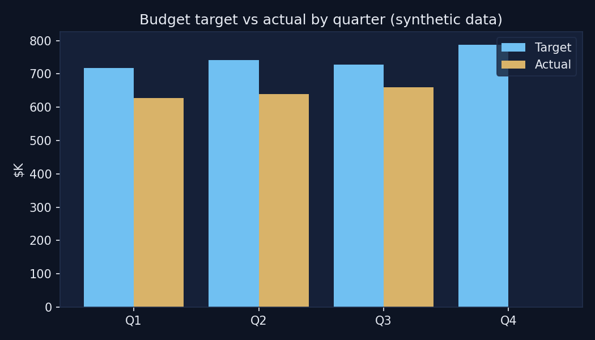
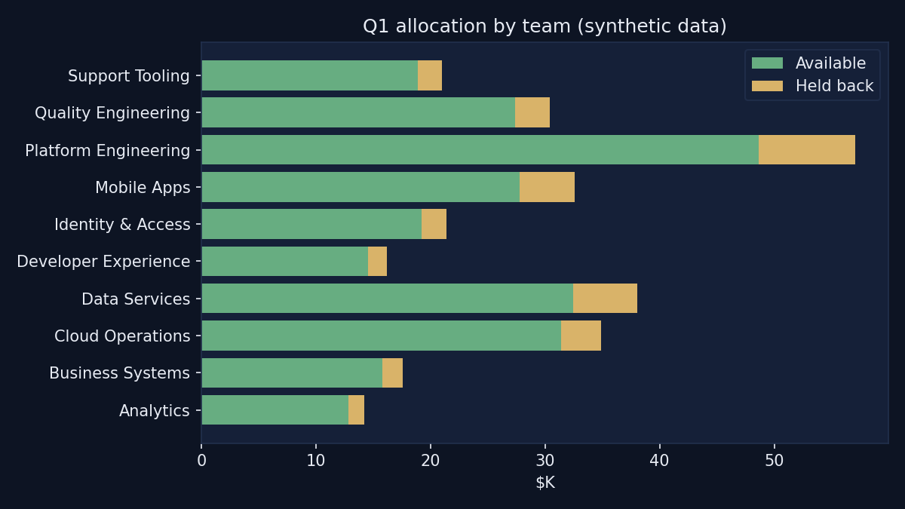

# Workforce & Spend Planner

A full-stack planning tool that replaces spreadsheet-based budget and headcount planning. Teams enter targets, headcount and per-head rates; the app computes allocations, hold-backs, variance and forecasts, and an AI assistant answers questions from live data.

> This repository is a **portfolio showcase**. It contains simplified code excerpts and entirely **synthetic data** for a fictional company ("Acme Corp"). It is not the production codebase and contains no client data.



## Problem and outcome

Finance leads managed travel, morale and training budgets plus headcount in linked spreadsheets: slow to update, easy to break, impossible to audit. The app gives them validated data entry, one set of calculation rules shared by every screen, an audit trail, and a dashboard they can open anytime.

## Architecture

```
React + TS (Vite)  ->  Express API  ->  Business rules  ->  Prisma  ->  Azure SQL
                                   \->  AI agent (tool calling)
GitHub Actions  ->  Azure App Service
```

Details and diagram: [docs/architecture.md](docs/architecture.md)

## Tech stack

React, TypeScript, Vite, Recharts, Node.js, Express, Prisma, Azure SQL, Azure App Service, GitHub Actions, Anthropic tool use

## Key features

- Paste / upload / form entry with a preview-before-commit validator
- Allocation engine: rate x headcount, team > location > default fallbacks, hold-back %
- Linear forecast with a widening confidence band
- Idempotent seeding that never overwrites user data
- Audit log and point-in-time views
- AI agent grounded in live data via tools
- CI/CD with typecheck gate and commit-verified smoke test

## Repository guide

| Folder | What's inside |
|---|---|
| [`docs/`](docs) | Architecture, data model, features, deployment |
| [`sample-data/`](sample-data) | Synthetic CSVs + generator script |
| [`snippets/01-schema`](snippets/01-schema) | Prisma schema |
| [`snippets/02-input-validation`](snippets/02-input-validation) | Paste/upload validator |
| [`snippets/03-allocation-engine`](snippets/03-allocation-engine) | Allocation + business rules + runnable demo |
| [`snippets/04-forecast`](snippets/04-forecast) | Forecast baseline |
| [`snippets/05-auto-seed`](snippets/05-auto-seed) | Idempotent seeding |
| [`snippets/06-api-routes`](snippets/06-api-routes) | Express routes |
| [`snippets/07-frontend`](snippets/07-frontend) | KPI tile + chart components |
| [`snippets/08-agent`](snippets/08-agent) | AI agent tools |
| [`snippets/09-ci-cd`](snippets/09-ci-cd) | GitHub Actions deploy workflow |
| [`outputs/`](outputs) | Sample outputs and charts |

## Try it

Requires Node 18+ and Python 3 (no packages needed for the demo).

```bash
python3 sample-data/generate_sample_data.py           # regenerate synthetic data
node snippets/03-allocation-engine/run_demo.js Q1     # run validation + allocation
python3 outputs/make_charts.py                        # needs matplotlib
```

## Sample output



## What I learned

- Why money columns need care with ORMs (Decimal vs Float pitfalls)
- Designing one source of truth for business rules across UI, API and an AI agent
- Making deployments safe: verifying the new build is live, and never overwriting user data
- Building validation that reports every error at once

## Author

Sri Rakurty
