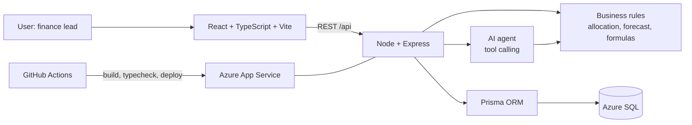

# Architecture

## Layers

**Frontend.** React + TypeScript (Vite), Recharts for charts. Tabs: Dashboard, Input, Reports, Analytics, Business Update, Guide, AI Agent. The built bundle is copied into `backend/public` and served by the same Express process, so there is one deployable unit.

**Backend.** Express routes are thin. All formulas (variance, deltas, allocation, hold-back, forecast) live in `lib/` as pure functions, so Reports, Analytics and the AI agent always agree.

**Data.** Prisma on Azure SQL, with `WSP_`-prefixed tables. Composite unique keys make every write an idempotent upsert. An audit log records who changed what.

**Agent.** Tool-calling only: the model can query the database and run forecasts, never invent numbers.

**Delivery.** GitHub Actions: typecheck, build, deploy, wait for the new commit to report healthy, then seed any empty datasets.

## Design decisions

| Decision | Why |
|---|---|
| Float, not Decimal, for money | Prisma returns Decimal as an object and `+` concatenates, corrupting totals silently |
| Business rules in one module | Same numbers in every screen and in the agent |
| Preview before commit on uploads | Users fix a whole file in one pass |
| Seed only empty datasets | A deploy can never overwrite user-entered figures |
| Health check reports commit SHA | Smoke test proves the *new* build is live |
| Linear forecast baseline | Explainable to finance users |
